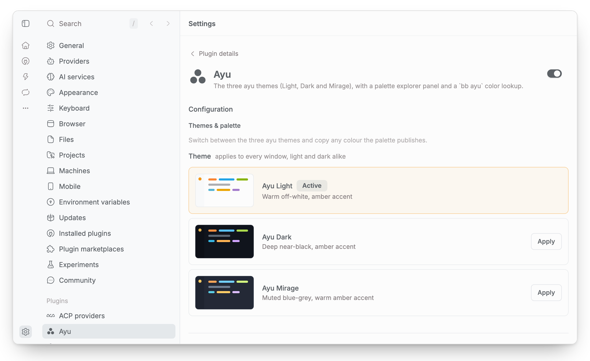
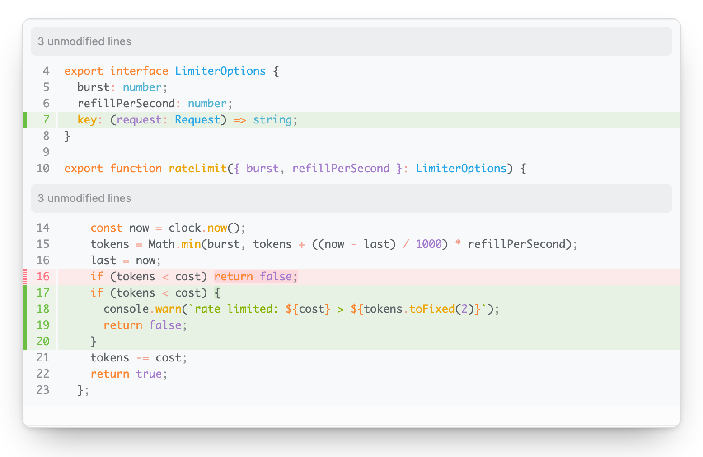
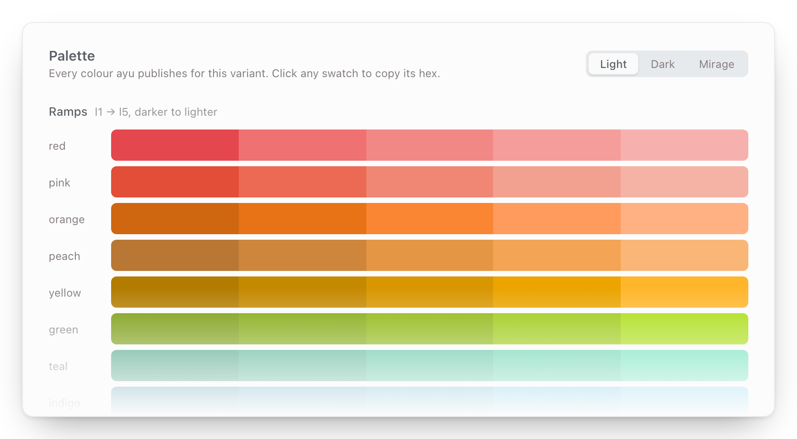
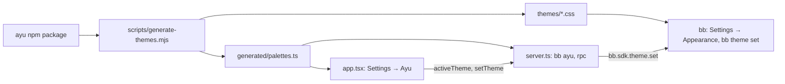

<h1 align="center">Ayu for bb</h1>

<p align="center"><b>The three <a href="https://github.com/ayu-theme/ayu-colors">ayu</a> themes for <a href="https://getbb.app">bb</a>: Light, Dark and Mirage.</b><br>With a palette explorer in Settings and a <code>bb ayu</code> color lookup for agents and scripts.</p>

<p align="center">
<a href="https://github.com/vburojevic/bb-plugin-ayu/releases/latest"></a>

<a href="LICENSE"></a>
<a href="https://github.com/get-bb/marketplace"></a>
</p>

<picture>
  <source media="(prefers-color-scheme: dark)" srcset="assets/screenshots/hero-dark.png">
  
</picture>

## Install

```sh
bb plugin install ayu
```

Or install straight from this repository:

```sh
bb plugin install git:https://github.com/vburojevic/bb-plugin-ayu.git
```

> [!TIP]
> Then pick a theme under **Settings → Appearance** or **Settings → Ayu**, or from a terminal:
>
> ```sh
> bb theme set plugin:ayu:ayu-dark
> ```

## The three themes

<p align="center"></p>

Each variant is a whole theme, the way ayu ships them everywhere else: one stylesheet paints both of bb's modes, so selecting Ayu Dark gives you Ayu Dark whichever way the light and dark switch is set.

```sh
bb theme set plugin:ayu:ayu-light
bb theme set plugin:ayu:ayu-dark
bb theme set plugin:ayu:ayu-mirage
```

<table>
<tr>
<td width="50%" valign="top">


### Ayu Light

Warm off-white, amber accent. A low-contrast palette by design.

</td>
<td width="50%" valign="top">


### Ayu Dark

Deep near-black, amber accent.

</td>
</tr>
<tr>
<td width="50%" valign="top">


### Ayu Mirage

Muted blue-grey, warm amber accent.

</td>
<td width="50%" valign="top">

<picture>
  <source media="(prefers-color-scheme: dark)" srcset="assets/screenshots/diff-dark.png">
  
</picture>

### Diffs and file previews

bb paints diffs, file previews and the file editor with a code theme of its own. Each ayu theme brings its matching ayu code theme along, so code reads the same everywhere in bb.

</td>
</tr>
</table>

> [!NOTE]
> The window chrome in the three theme images is a stand-in for bb's, with invented content. Every color in it is one the plugin ships. [About the screenshots](#about-the-screenshots) has the details.

## The Ayu panel

<table>
<tr>
<td width="50%" valign="top">

<picture>
  <source media="(prefers-color-scheme: dark)" srcset="assets/screenshots/panel-dark.png">
  
</picture>

### Switch themes

**Settings → Ayu** switches themes with live miniature previews drawn from each palette. The panel follows theme changes made anywhere else, from Settings → Appearance, `bb theme set` or another window.

</td>
<td width="50%" valign="top">

<picture>
  <source media="(prefers-color-scheme: dark)" srcset="assets/screenshots/palette-peek-dark.png">
  
</picture>

### Explore the palette

Below the switcher sits every color ayu publishes for the selected variant: ramps, syntax, terminal and interface. Click any swatch to copy its hex.

</td>
</tr>
</table>

<details>
<summary>The panel and the full palette in every variant</summary>
<br>

<table>
<tr>
<td width="50%" valign="top"></td>
<td width="50%" valign="top"></td>
</tr>
<tr>
<td width="50%" valign="top"></td>
<td width="50%" valign="top"></td>
</tr>
<tr>
<td width="50%" valign="top"></td>
<td width="50%" valign="top"></td>
</tr>
</table>

</details>

## `bb ayu`

For agents and scripts:

```sh
bb ayu themes                  # the three themes and the command that activates each
bb ayu colors light syntax     # resolved colors, filterable, --json available
```

<details>
<summary>Full CLI reference</summary>
<br>

```
bb ayu themes [--json]                     The three ayu themes and how to activate each
bb ayu colors [variant] [filter] [--json]  Resolved ayu colors
```

- `variant` is `light`, `dark` or `mirage`, and defaults to `dark`.
- `filter` matches dotted keys, for example `syntax` or `palette.orange`. A lone `bb ayu colors syntax` reads as a filter on the default variant.
- `--json` prints the same data as JSON: the theme list, or a key to hex map.

</details>

## How it works



<details>
<summary>Architecture</summary>
<br>

```
scripts/generate-themes.mjs   the single source of truth: upstream `ayu` npm
                              package -> themes/*.css + generated/palettes.ts
themes/*.css                  generated bb stylesheets (do not edit)
generated/palettes.ts         generated resolved palettes (do not edit)
themes-meta.ts                plain shared data (theme ids/names/variants)
server.ts                     rpc (active theme, switch via bb.sdk.theme),
                              realtime signal, `bb ayu` CLI
app.tsx                       the Settings-page panel, vendored shadcn components
scripts/generate-screenshots.mjs   the README images, rendered from the above
```

Palette data never crosses rpc: `generated/palettes.ts` is a plain module the frontend bundles directly. Only the active-theme read and the switch go through the backend, which uses `bb.sdk.theme.set()` (the same server API the Settings page uses) and publishes a `theme-changed` realtime signal so every open panel stays in sync.

</details>

<details>
<summary>How the palette maps onto bb tokens</summary>
<br>

**Ayu and bb stack their surfaces in opposite directions, and that governs the whole mapping.**

Ayu names three surfaces: `surface.base` (window chrome: sidebar, status bar), `surface.lift` (the editor), and `ui.panel`/`ui.popup` on top. Base is the *darkest*; the editor sits lifted above it.

bb has one anchor, `--canvas`, and derives everything else by mixing in `--ink`. Every derivation moves *away* from canvas, including the sidebar, which is always a step lighter. `--background`, `--card` and `--popover` are all plain `var(--canvas)`.

So `--canvas` is ayu's **`surface.lift`**, not `surface.base`. Anchoring on base inverts the hierarchy (sidebar renders lighter than content) and flattens the app into one tone. The surfaces ayu places below or above the editor are set explicitly:

| bb | ayu | vscode-ayu equivalent |
| --- | --- | --- |
| `--canvas` (⇒ `--background`) | `editor.bg` (`surface.lift`) | `editor.background` |
| `--sidebar` | `ui.bg` (`surface.base`) | `sideBar` / `statusBar` / `activityBar.background` |
| `--card`, `--surface-raised*` | `ui.panel.bg` | `dropdown.background`, `editorWidget.background` |
| `--popover` | `ui.popup.bg` | `menu.background` |
| `--secondary`, `--accent`, `--muted` | `ui.selection.*` | `list.hoverBackground` |
| `--surface-recessed*` | `ui.bg` (`surface.base`) | none |
| `--border*`, `--sidebar-border` | `ui.line` | `panel.border`, `sideBar.border` |
| `--input` | `ui.fg` @ 20% | `input.border` |
| `--state-hover` / `--state-active` | `ui.selection.*` | `list.hoverBackground` |
| `--surface-selected` | `ui.selection.active` | `list.activeSelectionBackground` |
| `--primary` / `--primary-foreground` | `common.accent.tint` / `.on` | `button.background` / `.foreground` |
| `--timeline-accent`, `--file-accent` | `syntax.entity` | none |
| `--destructive`, `--destructive-text` | `common.error` | `errorForeground` |
| `--warning`, `--attention` | `common.accent.tint` | `editorWarning.foreground` |
| `--success`, `--success-foreground`, `--diff-*` | `vcs.*` (success text in Ayu Light: `palette.green.l1`, see below) | `gitDecoration.*ResourceForeground` |
| `--ansi-0…15` | `terminal.*` | `terminal.ansi*` |

Two derived-fill traps worth knowing:

- `--surface-selected` defaults to solid `var(--primary)`. Left alone, every selected row is a block of amber. Ayu selects with a neutral wash.
- bb builds neutral fills by mixing `--ink` into `--canvas`, and ayu's ink is a **warm** grey while its surfaces are cool navy, so derived chips and wells come out tan (measured `#282225` against a `#10141c` app). The fills are set from `ui.selection` and `surface.base` instead.

</details>

<details>
<summary>Syntax highlighting, diffs and file previews</summary>
<br>

bb highlights chat code blocks with [sugar-high](https://github.com/huozhi/sugar-high), whose tokens read their color from `--sh-*` custom properties:

| sugar-high | ayu | |
| --- | --- | --- |
| `--sh-keyword` | `syntax.keyword` | `if`, `return`, `const` |
| `--sh-string` | `syntax.string` | |
| `--sh-comment` | `syntax.comment` | |
| `--sh-class` | `syntax.entity` | ayu: "class names, types, modules" |
| `--sh-entity` | `syntax.func` | ayu: "function names and calls" |
| `--sh-property` | `syntax.tag` | |
| `--sh-jsxliterals` | `syntax.tag` | JSX element names |

bb declares these **on `.bb-code-highlight` itself**, not on `:root`, so they must be overridden at element level; a `:root` block silently loses. The generated selector repeats `.dark .bb-code-highlight` to outrank bb's dark override at equal specificity (this stylesheet is injected last).

`--sh-identifier`, `--sh-sign` and `--sh-space` are deliberately left to bb: they already resolve to ayu's `editor.fg` and a dimmed tier of it, and sugar-high's `sign` covers *all* punctuation, so ayu's salmon operator color there would tint every bracket and comma.

bb paints diffs, file previews and the file editor with a code theme, not with the stylesheet. Each ayu theme declares Shiki's matching ayu theme as its `codeTheme` (`ayu-light`, `ayu-dark` or `ayu-mirage`, which bb bundles) for both modes, the same way its stylesheet paints both modes. Their editor background and foreground are the same colors this plugin's palette uses. Without the declaration bb falls back to its default `pierre-dark` / `pierre-light` code theme.

</details>

<details>
<summary>What is <i>not</i> taken from ayu</summary>
<br>

**The three secondary text tiers.** bb's own sit close to `--ink` (78% / 71.5% / 68% mixes) because `--muted-foreground` carries a lot of ordinary secondary text; ayu's `ui.fg` is a tab-label color, far too dim for that role. The tiers follow bb's anchor-derived recipe and pick the palette's hue up through `--ink` and `--canvas`.

**Success text in Ayu Light.** bb draws status text, such as a finished thread's sidebar label, in `--success-foreground`. Ayu Light's `vcs.added` is 2.2:1 on its canvas, so that one token takes the darkest green ayu publishes, `palette.green.l1` (3.3:1). The dark variants keep `vcs.added`.

**ANSI bright black on the dark variants**, where ayu 9 sets both black and bright black to near-black. Bright black is what dim terminal output is drawn in, so it falls back to `ui.fg`, the same substitution vscode-ayu makes.

Everything else is a color ayu publishes. Nothing is blended, darkened, or contrast-corrected: Ayu Light is a low-contrast palette by design, and "fixing" it produces muddy off-palette browns instead of ayu.

</details>

<details>
<summary>Developing</summary>
<br>

```sh
npm install
npm run generate        # regenerate themes/ + generated/ from the ayu package
npm run screenshots     # regenerate the rendered images in assets/screenshots/
npm run typecheck
bb plugin build         # bundle app.tsx -> dist/
bb plugin install .     # or: bb plugin dev  (watch loop)
```

UI components under `components/ui/` are vendored from the bb registry (shadcn model). Add more with `npx shadcn@latest add @bb/<name>`.

</details>

### About the screenshots

<details>
<summary>Which images are rendered and which are captured</summary>
<br>

**The theme, panel and palette images are rendered, not captured from a running bb.** `npm run screenshots` loads `themes/<id>.css` verbatim into a headless Chromium page over a small base layer that reproduces the token derivations bb performs but this plugin leaves alone (`--foreground`, `--ring`, the `--sh-*` defaults), then screenshots it at 2x. The code block is highlighted by sugar-high, the same library bb uses, so the `--sh-*` mapping above is exercised for real.

Every color in those images is therefore a color the plugin actually ships, and regenerating after a palette change keeps them honest. The window layout is a stand-in for bb's chrome; the content is invented. Nothing comes from anyone's bb instance.

**The hero and the diff images are captured** from bb 0.49 itself, running headless with its own empty data folder and this plugin installed. The diff shows an invented change to a sample file.

</details>

Colors are MIT-licensed by the ayu project (Ike Ku / Konstantin Pschera).

---

<p align="center">See every bb plugin I publish at <a href="https://github.com/vburojevic/bb-plugins"><b>vburojevic/bb-plugins</b></a>.</p>
